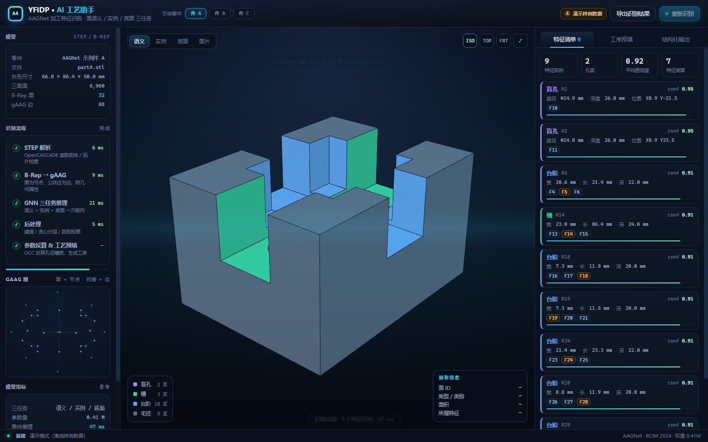

# AAGNet 加工特征识别 · 交互演示

面向「YFIDP · AI 工艺助手（基于 AAGNet 的加工特征智能识别）」参赛方案的**可现场演示原型**：
导入零件 → 面级分割 → 特征实例 → 三视图着色 → gAAG 图 → 特征清单 → 工艺预填 → 结构化 JSON。

**零依赖、离线可用**：纯单页 WebGL，不需要 Python / Node / 服务器 / 联网，双击即可打开。



---

## 1. 怎么打开

| 方式 | 操作 |
|---|---|
| 在线看（推荐分享） | 打开 GitHub Pages 地址：`https://<你的用户名>.github.io/aagnet-demo/` |
| Windows 一键 | 双击 `start-demo.bat` |
| 任意系统 | 直接双击 `index.html`（Chrome / Edge / Safari 均可） |

要求：浏览器支持 WebGL2（近 5 年的 Chrome/Edge 都支持）。若模型区黑屏，见文末「常见问题」。

> ⚠️ 注意：**在 GitHub 网页上点 `index.html` 只会显示源码，不会渲染页面**。要在线运行必须开启 GitHub Pages（见第 2 节），或把仓库下载到本地后双击 `index.html`。
> `start-demo.bat` 仅 Windows 有效；macOS / Linux 请直接双击 `index.html`。

目录内容：

```
aagnet-demo/
├── index.html              演示页（渲染 / 拾取 / 交互 / UI 全在单文件内）
├── data.js                 内嵌演示数据（3 个零件的几何 + 面属性 + 实例 + gAAG 边）
├── data.json               同上，JSON 版（供外部系统读取 / 联调）
├── start-demo.bat          Windows 一键打开
├── docs/preview.png        README 预览图
├── tools/                  数据构建与自检脚本（演示时不需要，需要额外 STL，见第 5 节）
│   ├── build_data.py       STL → 焊接 → 面分割 → 面属性 → 实例 → 输出 data.js/json
│   ├── features.py         实例组装规则（通孔/盲孔/型腔/槽/台阶）
│   ├── render_preview.py   离线软件光栅化出图（无浏览器时校核用）
│   ├── qa.js               CDP 自动化点击走查 + 截图
│   └── shot_show.js        生成展示用截图
└── (shots/)                本地 QA 截图目录，已 gitignore，不在仓库里
```

---

## 2. 发布到 GitHub / 开启在线演示

仓库是纯静态页，**不需要任何构建步骤**，直接上传即可。

```bash
git clone <你的仓库地址> && cd aagnet-demo      # 或直接在本地仓库提交推送
git add . && git commit -m "feat: AAGNet 特征识别交互演示"
git push
```

开启在线运行（GitHub Pages）：

1. 仓库 → **Settings → Pages**
2. *Source* 选 **Deploy from a branch**，分支选 **main**，目录选 **/(root)**
3. 等 1~2 分钟，访问 `https://<你的用户名>.github.io/aagnet-demo/`

页面所有资源都是相对路径（`data.js` 同目录），放在子路径下也能正常加载，无需改代码。

---


## 3. 三分钟演示脚本（建议照此讲）

1. **开场（10 s）**
   指着页面顶部徽标：「这是参赛方案的演示原型，**演示样例数据**——几何是真的，特征推理是离线规则模拟，不是网络实测推理」。这句话先讲，后面所有数字都不会被追问穿帮。

2. **STEP → gAAG（20 s）**
   左侧「识别流程」逐项亮起：`STEP 解析 → B-Rep → gAAG → GNN 三任务推理 → 后处理 → 参数反算 & 工艺预填`。
   强调：**面是节点、公共边是边、附几何属性**——这正是 gAAG 图的定义，也是 AAGNet 相对 UV-Net（只看几何点云/体素）的核心差别：B-Rep 的拓扑与面边界信息被完整保留。

3. **三任务分割（60 s）**
   - 点 `语义`：面按加工语义着色（孔 / 型腔 / 槽 / 台阶 / 毛坯）。
   - 点 `实例`：同一类别的不同实例用色相区分——说明网络输出的是**面级**标签，实例要靠后处理（同轴同径聚类、共享边归属）拼出来。
   - 点 `底面`：只亮特征底面。讲这一层最值钱——**底面是"加工到哪一层"的直接证据**，工艺排序和余量都从它来。
   - 点 `面片`：随机配色，展示 32 个 B-Rep 面本身的分割结果。

4. **拾取与特征清单（40 s）**
   在模型上点一个面：右下「拾取信息」显示面 ID / 类型 / 面积 / 归属特征；右侧清单里点任一特征卡片，3D 视图高亮整组面并描边，同时展示参数（Φ14.9 mm 深 26.0 mm、位置 X0.9 Y-21.5…）。
   讲：**每个识别结果都能反查参数量**，这是工艺员敢用的前提。

5. **工艺预填（40 s）**
   切到「工序预填」：铣基准面 → 铣槽 → 铣台阶 → 钻孔（麻花钻 Φ14.9）→ 去毛刺/倒角，附刀具、转速进给、工时、状态（可采纳 / 需确认）。
   讲：这一步把"识别"接到"干活"——置信度低于阈值的自动标「需确认」，人来兜底。

6. **结构化输出（30 s）**
   切到「结构化输出」，展示 JSON：零件元信息 + 面级标签 + 实例 + 工艺。说明这就是交给 YFIDP 特征树 / 工艺模板的接口格式。

7. **重新识别（20 s）**
   点右上「重新识别」→ 流程动画重跑、计时器走动。这一下是为了让评委看到它是**在算**，不是静态图片。

8. **换零件（20 s）**
   切「件 B」（简单铣件）、「件 C」（复杂件，91 面，部分面未归类——**主动说明覆盖不足**，并讲"这就是为什么要上真网络"）。诚实收尾比吹精度加分。

---

## 4. 数据口径（重要，勿改）

| 项 | 真实 / 模拟 |
|---|---|
| 几何 | **真实**：`AAGNet-main/examples/partA/B/C.stl`（partA 6960 三角面，外形 66.8×86.4×50.0 mm） |
| 面级分割 | **离线算法**：顶点焊接 + 二面角（28°）区域生长，得到近似 B-Rep 面（A 32 / B 31 / C 91 面） |
| 面属性 | **真实计算**：平面/圆柱判别、Kasa 圆拟合半径与轴线、面积、质心、包围盒 |
| gAAG 边 | **真实计算**：面邻接（共享边），A 88 / B 84 / C 264 条 |
| 特征实例 | **规则启发式**（`tools/features.py`），**不是网络输出** |
| 计时（6/9/21/5 ms） | **演示用示意值**，非实测 |
| 98.2% 面准确率 / 0.41 M 参数 / 47 ms 单件推理 | **论文口径（MFInstSeg）**，页面已注明"参考"，未在本机重算 |
| 工时 / 刀具 / 转速 | 按规则预填的**示例工艺**，需工艺员确认 |

任何宣传材料里请不要把上述"模拟/示意"项写成实测精度——这是评审最容易也最值得被信任的一点。

---

## 5. 数据是怎么造出来的（想改就改这几步）

重建数据需要**样例 STL**（`partA/B/C.stl`，来自 AAGNet 官方仓库的 `examples/`，体积原因未随本仓库分发）。脚本按以下顺序找它：

1. 环境变量 `AAGNET_EXAMPLES` 指向的目录；
2. 默认 `<本仓库上级目录>/AAGNet-main/examples`（即把 AAGNet 仓库 clone 到与本仓库同级）。

```powershell
# 目录结构：<父目录>/aagnet-demo 与 <父目录>/AAGNet-main 并列
cd aagnet-demo
python tools\build_data.py      # 约 30 s，重写 data.js / data.json
```

如果 STL 放在别处，指定一下即可（Windows PowerShell 示例）：

```powershell
$env:AAGNET_EXAMPLES = "D:\datasets\AAGNet-main\examples"
python tools\build_data.py
```

`build_data.py` 关键步骤：
1. ASCII STL 解析 → 顶点量化焊接（1e-5）→ 三角面合并为 `(v0,v1,v2)` 顶点表；
2. 区域生长：相邻三角面二面角 < 28° 合并为同一面 → 面 ID 表；
3. 每面拟合：法向协方差判平面/圆柱、Kasa 圆拟合、面积、质心、bbox；
4. 面邻接建 gAAG 边，记录共享边长（用于实例归属）；
5. 单位自适应：包围盒对角线 > 3000 视为 μm 自动换算 mm；
6. 写 `data.js`（`window.AAG_DEMO=[...]`）与 `data.json`。

想换零件：把 STL 放进样例目录，在 `build_data.py` 末尾的零件清单里加一行即可。

> 依赖：`numpy`。`shots/` 截图目录已加入 `.gitignore`（约 20 MB），需要时用 `tools/render_preview.py` 或 `tools/qa.js` 重新生成。

---

## 6. 通往真实推理的接入路径

演示页只认 `window.AAG_DEMO` 这一份数据结构，所以替换后端不用改前端：

1. **OCC 解析**：Python（pythonocc-core）读 STEP → `TopExp_Explorer` 遍历面 → 每面取 `BRepAdaptor_Surface`（平面/圆柱/圆锥…）、面积 `GProp_GProps`、邻接 `TopExp_MapShapesAndAncestors`。
2. **构 gAAG**：面→节点（类型 one-hot + 几何属性归一化），共享边→边（凸凹、边长、二面角）。
3. **跑 AAGNet**：`AAGNet-main` 仓库 + `weights/weight_on_MFInstseg.pth`，一次前向出 语义 / 实例 / 底面 三组 logits。
4. **后处理 → 实例参数**：同轴同径聚类成孔、共享边最长归属成腔槽、OCC 反算半径/深度/位置。
5. **产出同结构 JSON**：字段对齐 `data.json`（`parts[].faces[] / instances[] / edges[] / size_mm`），把 `data.js` 整个覆盖即可，前端零改动。

替换后请把页面上「演示样例数据」徽标、「演示模式」页脚、以及流程里的示意计时一并改成实测值——**徽标就是给评委会的诚实承诺**。

---

## 7. 已知限制

- **分割是几何近似**：C 件 91 面中有过分割，71 个面未归入任何实例（页面图例与脚注已如实标注）。A 件 32 面、9 实例覆盖较好；B 件 31 面、6 实例。
- **规则不是学习**：孔的通/盲由"两端是否都有端盖面"判定，腔槽由"上升墙面方向数 ≥3 / 长宽比"判定，遇到非轴类特征（自由曲面、螺纹、斜顶孔）会退化。
- **不做碰撞/可达性/装夹分析**，工艺排序是模板顺序，不含真正的工艺决策。
- 面拾取用离屏 ID 缓冲（RGB 编码面 ID），面数 > 16.7 M 才会溢出，本演示远未触及。

---

## 8. 常见问题

- **模型区黑屏 / 只有底色**：显卡驱动或远程桌面禁用硬件加速。Chrome 打开 `chrome://gpu` 确认 WebGL 可用；远程桌面下可加启动参数 `--enable-unsafe-swiftshader`（软件渲染，帧率低但可用）。
- **页面空白、右侧清单为空**：`data.js` 没加载（被安全软件拦截、或 `data.js` 不在同目录）。检查同目录是否有 `data.js`，大小约 423 KB。
- **在线版打不开 / 404**：确认 GitHub Pages 已开启且分支/目录选对（见第 2 节）；仓库若为私有，Pages 需 GitHub Pro 或改为公开仓库。
- **字体偏小**：页面按 1600×1000 设计，投屏建议 1080p 全屏（F11）；更小窗口会压缩右侧清单。
- **截图发白/看不清**：本地重新生成的 `shots/*.png` 是自写 zlib 编码，部分查看器不认；同目录 `*_v.png` 是 GDI+ 重编码的版本（可用 `tools/png_fix.ps1` 批量转换），用这些。

---

*演示原型 · 几何与拓扑真实，特征推理为规则模拟；对外表述以第 4 节口径为准。*
